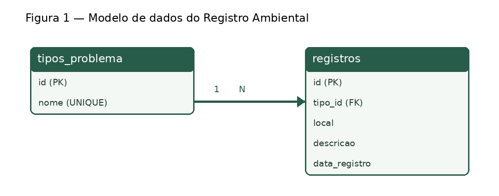

# Banco de dados — Registro Ambiental

Banco SQLite de demonstração do Módulo 3 do Projeto Integrador de Tecnologia da Informação II.

## Modelo



- `tipos_problema` guarda as categorias do formulário. Cada categoria tem um `id` como chave primária e um nome obrigatório e único.
- `registros` guarda as ocorrências. Cada linha tem um `id` como chave primária e um `tipo_id` obrigatório que referencia a categoria.
- A relação é 1:N. Uma categoria pode ter zero ou vários registros, e cada registro pertence a uma categoria. Guardar o nome da categoria em uma tabela própria evita repeti-lo em cada ocorrência.
- Local e descrição são obrigatórios. O SQLite verifica conteúdo e os limites de 100 e 400 caracteres, seguindo os limites do formulário. A data é preenchida automaticamente pelo banco.

## Organização e execução

- `01_estrutura.sql` cria as tabelas e ativa as chaves estrangeiras na conexão SQLite.
- `02_operacoes.sql` demonstra INSERT, SELECT com JOIN, UPDATE e DELETE. A alteração e a exclusão usam o identificador retornado pela inserção de cada exemplo.
- `testar_banco.py` executa os scripts em SQLite em memória e verifica as operações, as categorias e as restrições.

Na raiz do projeto, execute com Python 3.11 ou superior:

```powershell
python banco/testar_banco.py
```

Use o teste para repetir a demonstração com uma base nova a cada execução. O script de operações insere dados fictícios e deve ser usado em base de teste. Em uma ferramenta SQL, rode os dois arquivos na mesma conexão, começando pela estrutura. O arquivo de estrutura foi feito para criar a base, sem migração de tabelas existentes.

## Padrões do projeto

- A interface, o foco, as mensagens e as ações de cadastro, consulta e exclusão continuam centralizados no `index.html`, com HTML, CSS, Bootstrap e JavaScript. A página usa `localStorage` e o UPDATE pertence à demonstração em SQL.
- O banco fica em `banco/` como exercício local. Os scripts reaproveitam o modelo de duas tabelas já presente no repositório e seguem os campos, as categorias e os limites do formulário.
- As restrições do SQLite protegem os dados da demonstração. O teste usa dados fictícios isolados em memória e encerra com falha quando o resultado diverge do esperado.
